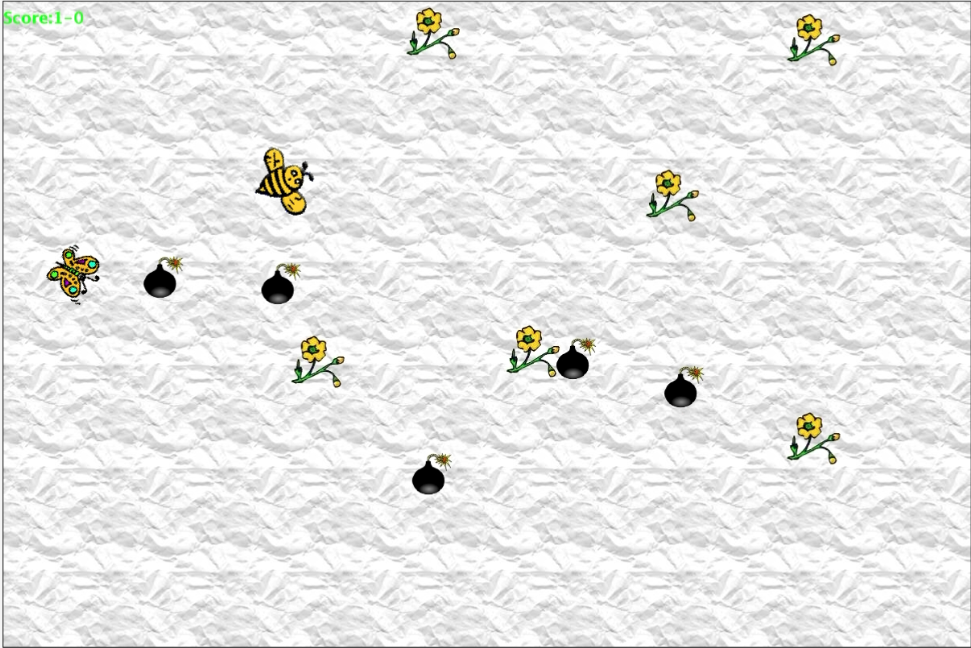

# Bee Careful 🌻🐝
2-player arcade game (April 2018)

# Gameplay
- Control the bee (arrow keys) or the butterfly (WASD)
- Collect flowers to score points, avoid the bombs!

# Technical
- Uses Greenfoot (Java graphics framework)
- Features collision detection with sprites
- Object-oriented programming
- My first graphics-based game!

